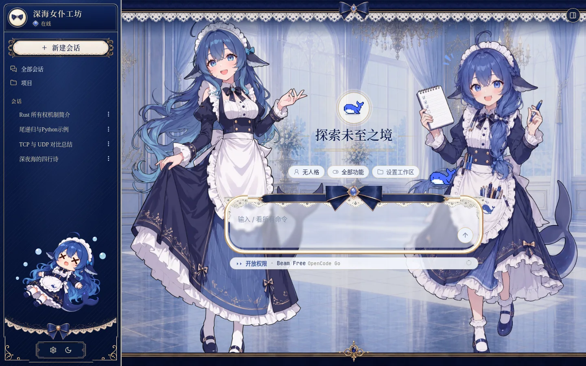
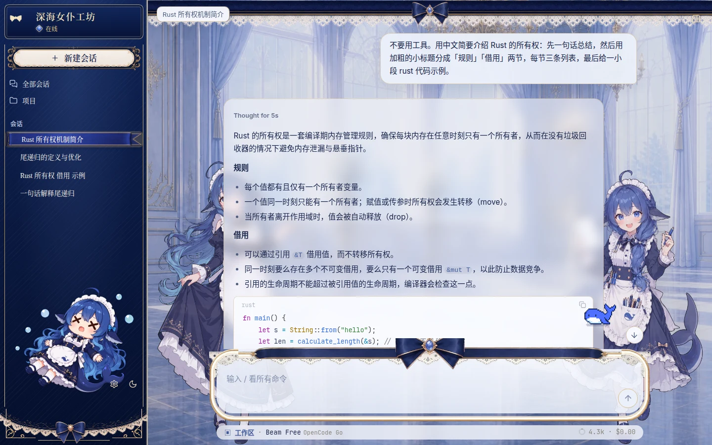
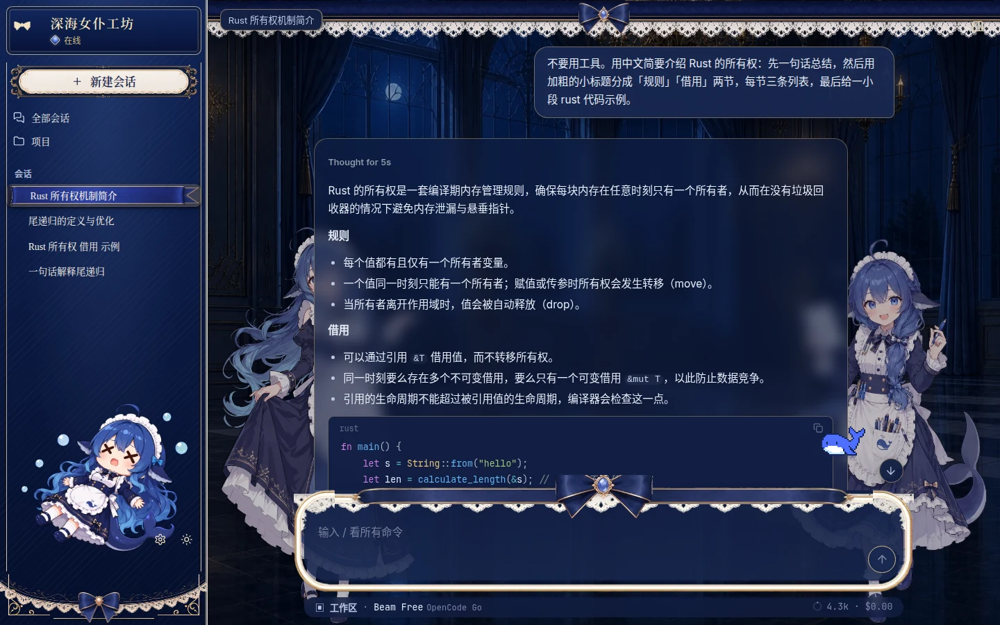

# miyu-webui-theme-deep-whale · 大肥鱼深海女仆工坊网页皮肤

[Miyu](https://github.com/miyu-agent/miyu) 网页界面的外观包「深海女仆工坊」：鲸鱼娘女仆、深海蓝蕾丝、宫殿大厅（白天、夜里两张），输入框上有像素小鲸鱼 Deepy。

移植自 Small-tailqwq 的 [dsh-deep-whale](https://github.com/Small-tailqwq/dsh-deep-whale) 里的 maid-atelier 皮肤。



| 对话 | 对话 · 夜里 |
|---|---|
|  |  |

## 装

```sh
miyu pkg install webui-theme-deep-whale
```

装好后在网页的 设置 → 通用 → 主题 选「深海女仆工坊」，配色方案和吉祥物会一起切过去；配色、吉祥物也可以再单独换。要先装好网页界面（webui）。

## 授权

代码 MIT（LICENSE）。美术（web/art/）照 CC BY-NC-SA 4.0（LICENSE-ARTWORK）：只能非商业使用，保留署名，衍生作品照同一许可。署名链：上善 → ZipZipPipe → Small-tailqwq，详见 NOTICE。

DeepSeek 的名称和标志是杭州深度求索人工智能基础技术研究有限公司的商标。本包是第三方作品，与 DeepSeek 没有关联，也没有经过它的认可或授权。

---

A whale-girl maid theme for the Miyu web UI, ported from dsh-deep-whale. Code MIT; artwork CC BY-NC-SA 4.0 with attribution chain in NOTICE. DeepSeek and its logo are trademarks of Hangzhou DeepSeek Artificial Intelligence Co., Ltd.; this is a third-party package, not affiliated with, endorsed by or sponsored by DeepSeek.
