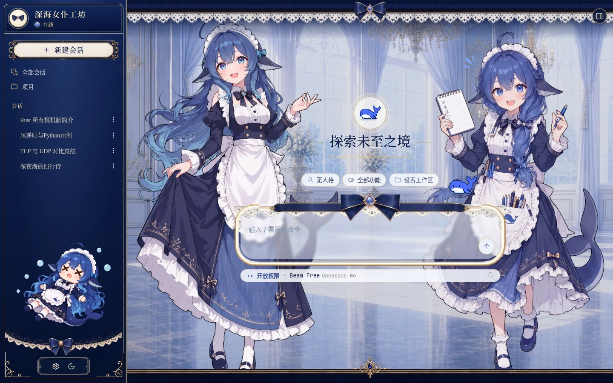
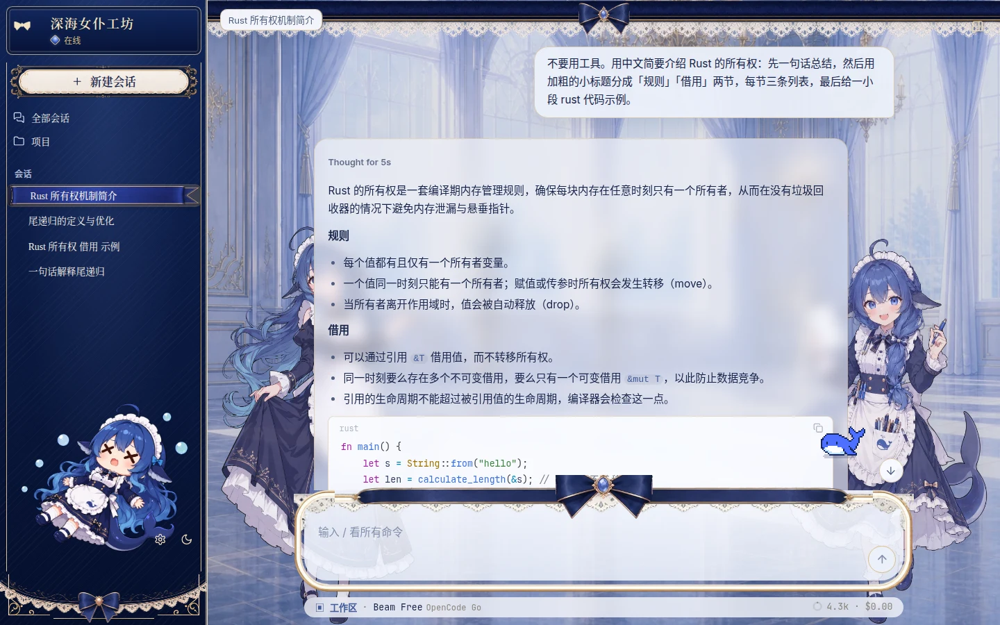
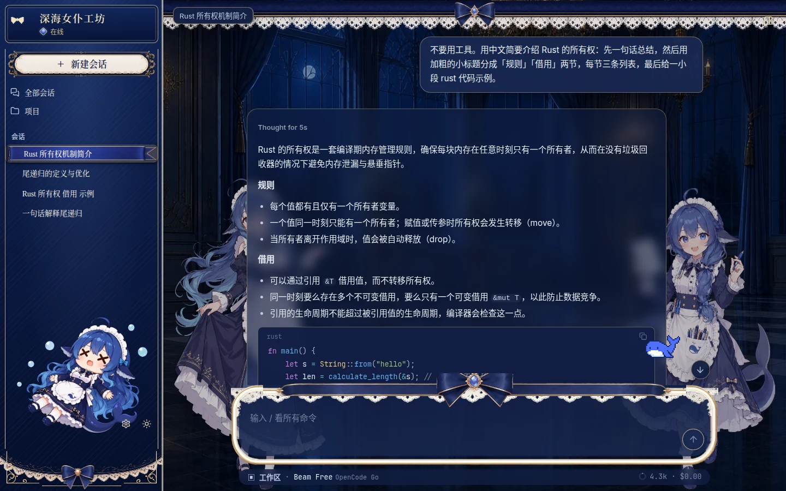

<p align="center">
  <a href="README.md">English</a> | 简体中文
</p>

# 大肥鱼深海女仆工坊网页皮肤（miyu-webui-theme-deep-whale）

> <sub>本文档由 Anthropic 的 Claude Fable 5.2 生成。</sub>

这是 [Miyu](https://github.com/miyu-agent/miyu) 网页界面的一个外观包，名叫「深海女仆工坊」：画面里有鲸鱼娘女仆、深海蓝的蕾丝和宫殿大厅（白天、夜里各一张），输入框上还有一只像素小鲸鱼 Deepy。

这个外观包移植自 Small-tailqwq 的 [dsh-deep-whale](https://github.com/Small-tailqwq/dsh-deep-whale) 中的 maid-atelier 皮肤。



| 对话 | 对话 · 夜里 |
|---|---|
|  |  |

## 安装

使用这个外观包之前，需要先安装网页界面（`webui`）。然后运行：

```sh
miyu pkg install webui-theme-deep-whale
```

安装完成后，在网页界面的 `设置 → 通用 → 主题` 里选择 `深海女仆工坊`，配色方案和吉祥物会一起切换过去；之后也可以再单独更换配色方案和吉祥物。

## 修改代码

修改代码以后，在仓库根目录运行 `node --test tests/` 进行测试（需要 Node 22.7 以上，不需要安装其他依赖）。发布新版本时，`package.toml` 和 `web/manifest.json` 里的 `version` 要一起修改，测试会核对两处是否相同。

测试还会检查被 git 跟踪的文件里有没有带真实用户名的路径（`tests/privacy.test.js`）。因为仓库公开可见，所以样例里需要用到家目录时，请使用这个文件里列出的虚构名字，例如 `/home/alice`。

`web/sprite.js`（吉祥物的播放器）和 `web/body.js`（吉祥物的身体）在这个外观包和 Claude 风格网页皮肤（[miyu-webui-theme-claude-style](https://github.com/SHORiN-KiWATA/miyu-webui-theme-claude-style)）里各有一份，内容完全相同，所以修改其中一份时，要在两个包里同时修改。测试会拿这个仓库旁边 `miyu-webui-theme-claude-style` 目录里的同名文件逐字节对比，你也可以用环境变量 `MIYU_THEME_PEER` 指定另一个包的位置；如果没有克隆另一个包，这两条测试会被跳过。以后网页界面会提供共享模块，到那时这两个文件就不需要各放一份了。

## 许可证

代码使用 MIT 许可证，见 `LICENSE`。美术（`web/art/`）使用 CC BY-NC-SA 4.0 许可证，见 `LICENSE-ARTWORK`：美术只能用于非商业用途，必须保留署名，衍生作品要使用同一许可证。署名链是上善 → ZipZipPipe → Small-tailqwq，详细的见 `NOTICE`。

DeepSeek 的名称和标志是杭州深度求索人工智能基础技术研究有限公司的商标。这个外观包是第三方作品，与 DeepSeek 没有关联，也没有经过 DeepSeek 的认可或授权。
